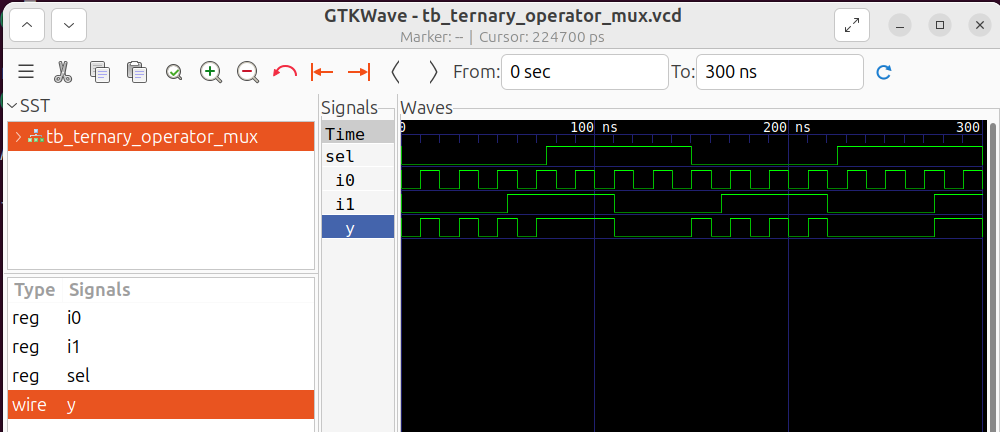
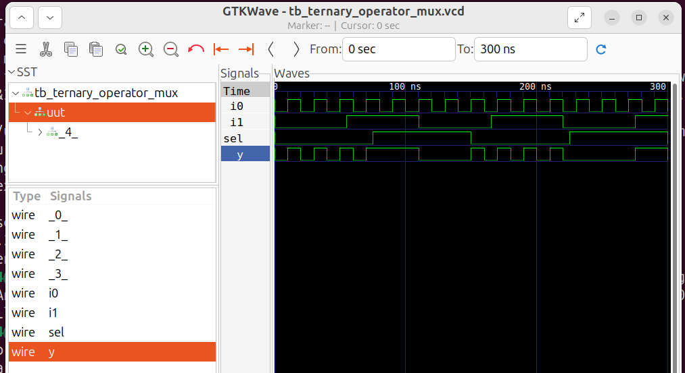
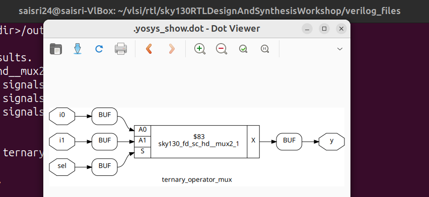
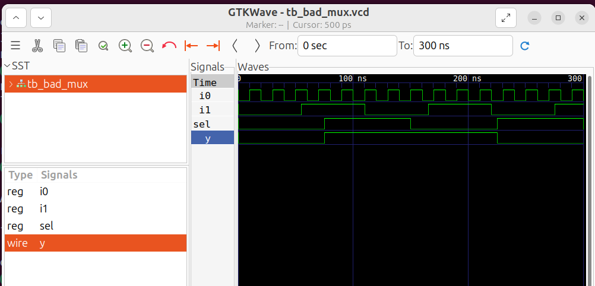
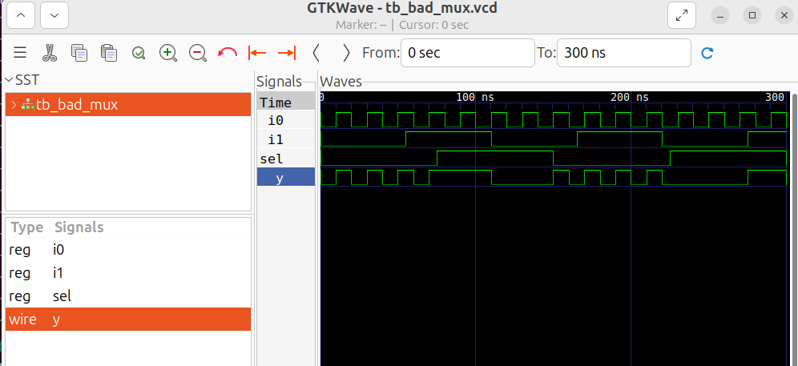
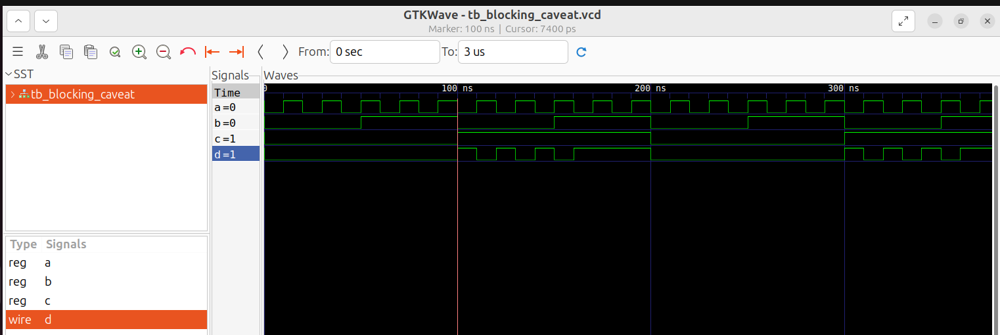
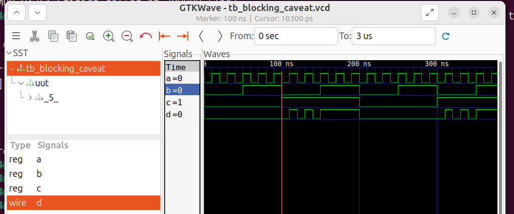
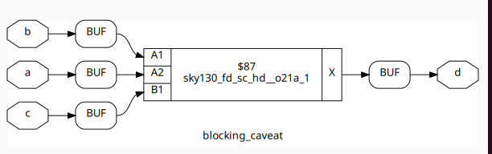

# Day 4 – Gate-Level Simulation (GLS)

## Index

1. [Introduction to Gate-Level Simulation](#1-introduction-to-gate-level-simulation)
2. [Ternary Operator MUX – RTL and Gate-Level Simulation](#2-ternary-operator-mux--rtl-and-gate-level-simulation)
3. [Bad MUX – RTL and Gate-Level Simulation](#3-bad-mux--rtl-and-gate-level-simulation)
4. [Blocking Assignment Caveat](#4-blocking-assignment-caveat)
5. [Learning Outcomes and Conclusion](#5-learning-outcomes-and-conclusion)

---

## 1. Introduction to Gate-Level Simulation

### 1.1 What is Gate-Level Simulation?

Gate-Level Simulation (GLS) is the process of simulating a synthesized gate-level netlist instead of the original behavioural RTL code.

During RTL simulation, the Verilog design is simulated directly using its behavioural description. During GLS, the synthesized netlist is simulated using standard-cell Verilog models from the target technology library.

In this workshop, the SKY130 standard-cell library was used to perform gate-level simulation and verify the behaviour of synthesized designs.

### 1.2 RTL Simulation vs Gate-Level Simulation

| RTL Simulation                                    | Gate-Level Simulation                         |
| ------------------------------------------------- | --------------------------------------------- |
| Uses the original Verilog RTL code.               | Uses the synthesized gate-level netlist.      |
| Describes the intended circuit behaviour.         | Represents the actual mapped logic structure. |
| Does not require standard-cell functional models. | Requires standard-cell Verilog models.        |
| Helps verify functionality before synthesis.      | Helps verify the synthesized implementation.  |

### 1.3 Steps Involved in Gate-Level Simulation

The following steps were performed during the workshop:

**Step 1: RTL Simulation**

The original Verilog design and its testbench are compiled using Icarus Verilog. The simulation output is observed using GTKWave to verify the expected functionality.

**Step 2: RTL Synthesis using Yosys**

The RTL design is synthesized using Yosys. The synthesized circuit is inspected using the `show` command to understand the logic implementation.

**Step 3: Generate the Gate-Level Netlist**

The synthesized design is exported into a Verilog netlist using:

```yosys
write_verilog -noattr design_net.v
```

This generates a Verilog representation of the synthesized circuit without Yosys-specific attributes.

**Step 4: Gate-Level Simulation**

The generated netlist is simulated using Icarus Verilog along with:

* `primitives.v` – Contains supporting primitive definitions.
* `sky130_fd_sc_hd.v` – Contains the functional Verilog models of SKY130 high-density standard cells.
* The original testbench – Provides the same input stimulus used during RTL simulation.

**Step 5: Compare the Results**

The RTL simulation waveform and GLS waveform are compared to identify any differences in the output behaviour.

This comparison helps verify whether the synthesized implementation preserves the intended functionality.

---

## 2. Ternary Operator MUX – RTL and Gate-Level Simulation

### 2.1 Introduction

A 2:1 multiplexer was designed using the Verilog ternary conditional operator.

The ternary operator provides a compact way of describing conditional selection logic.

**Verilog Expression:**

```verilog
assign y = sel ? i1 : i0;
```

**Working Principle:**

* When `sel = 0`, the output `y` follows `i0`.
* When `sel = 1`, the output `y` follows `i1`.

The design was first simulated at RTL and then synthesized using Yosys to generate a gate-level netlist.

### 2.2 RTL Simulation

**Commands:**

```bash
iverilog ternary_operator_mux.v tb_ternary_operator_mux.v

./a.out

gtkwave tb_ternary_operator_mux.vcd
```

### 2.3 Gate-Level Simulation

After RTL simulation, the design was synthesized using Yosys and the resulting netlist was saved as `ternary_operator_mux_net.v`.

The generated netlist was then simulated using the SKY130 standard-cell functional models.

**Commands:**

```bash
iverilog ../my_lib/verilog_model/primitives.v ../my_lib/verilog_model/sky130_fd_sc_hd.v ternary_operator_mux_net.v tb_ternary_operator_mux.v

./a.out

gtkwave tb_ternary_operator_mux.vcd
```

**Command Explanation:**

* `primitives.v` – Provides the supporting primitive definitions required by the standard-cell models.
* `sky130_fd_sc_hd.v` – Provides the functional models of the SKY130 high-density standard cells.
* `ternary_operator_mux_net.v` – Contains the synthesized gate-level netlist.
* `tb_ternary_operator_mux.v` – Provides the same testbench stimulus used for RTL simulation.
* `./a.out` – Executes the gate-level simulation.
* `gtkwave` – Displays the generated GLS waveform.

### 2.4 RTL vs Gate-Level Simulation Comparison

| Experiment                | Screenshot                                                       |
| ------------------------- | ---------------------------------------------------------------- |
| **RTL Simulation**        |         |
| **Gate-Level Simulation** |  |

### Observations
**The synthesized netlist is working as expected.**

### 2.5 Synthesized Circuit using Yosys

The synthesized circuit was also inspected using the Yosys `show` command to understand the hardware implementation of the ternary operator multiplexer.

**Image 3: Yosys synthesized circuit of the ternary operator multiplexer.**



---

## 3. Bad MUX – RTL and Gate-Level Simulation

### 3.1 Introduction

In this experiment, a multiplexer design with an RTL coding issue was analyzed.

The design was simulated at RTL and then synthesized using Yosys. Both simulation results were compared to understand how the synthesized implementation behaves.

This exercise demonstrates why it is important to verify the synthesized netlist rather than relying only on RTL simulation.

### 3.2 RTL vs Gate-Level Simulation Comparison

| Experiment                | Screenshot                                               |
| ------------------------- | -------------------------------------------------------- |
| **RTL Simulation**        |         |
| **Gate-Level Simulation** |  |

### Observations

A difference was observed between the RTL simulation and the gate-level simulation.

**RTL Simulation:**

* The RTL waveform does not exhibit the expected multiplexer output behaviour.

**Gate-Level Simulation:**

* When `sel = 0`, the output `y` follows `i0`.
* When `sel = 1`, the output `y` follows `i1`.
* The synthesized gate-level implementation exhibits the expected multiplexer behaviour.

This comparison demonstrates that an RTL simulation result and its synthesized implementation can differ when the RTL coding style or simulation semantics are problem

The mismatch is observed
---

## 4. Blocking Assignment Caveat

### 4.1 Introduction

In Verilog, blocking and non-blocking assignments are two different ways of updating signal values.

Choosing the correct assignment type is important, especially when writing sequential logic.

Incorrect use of blocking assignments in clocked processes can lead to simulation mismatches and unexpected behaviour.

### 4.2 Difference Between Blocking and Non-Blocking Assignments

| Feature            | Blocking Assignment (`=`)                                  | Non-Blocking Assignment (`<=`)                                                  |
| ------------------ | ---------------------------------------------------------- | ------------------------------------------------------------------------------- |
| Execution          | Executes immediately in procedural order.                  | Schedules the update for the end of the current simulation time step.           |
| Data update        | Updates the variable before executing the next statement.  | Evaluates the right-hand side immediately but updates the left-hand side later. |
| Coding usage       | Commonly used in combinational logic.                      | Commonly used in sequential logic.                                              |
| Execution order    | Statements execute one after another.                      | Updates are scheduled and applied together.                                     |
| Hardware modelling | Can create simulation-order dependencies in clocked logic. | Models simultaneous register updates more naturally.                            |
| Main application   | `always @(*)` or `always_comb`.                            | `always @(posedge clk)` or `always_ff`.                                         |

### 4.3 Example of Blocking Assignment

Consider the following example:

```verilog
always @(posedge clk)
begin
    q1 = d;
    q2 = q1;
end
```

**Explanation:**

When a positive clock edge occurs:

1. `q1` is immediately updated with the value of `d`.
2. The next statement executes.
3. `q2` receives the newly updated value of `q1`.

Therefore, both `q1` and `q2` can receive the same value during the same clock event.

### 4.4 Example of Non-Blocking Assignment

Consider the same logic using non-blocking assignments:

```verilog
always @(posedge clk)
begin
    q1 <= d;
    q2 <= q1;
end
```

**Explanation:**

When a positive clock edge occurs:

1. The value of `d` is scheduled to update `q1`.
2. The current value of `q1` is scheduled to update `q2`.
3. Both updates are applied at the end of the current simulation time step.

Therefore, `q2` receives the previous value of `q1`, modelling two cascaded flip-flops.

### 4.5 Timing Example

Assume the initial values are:

```text
q1 = 0
q2 = 0
d  = 1
```

At the positive clock edge at 100 ns:

**Blocking Assignment (`=`):**

| Time          | Operation      | q1 | q2 |
| ------------- | -------------- | -- | -- |
| Before 100 ns | Initial values | 0  | 0  |
| 100 ns        | `q1 = d`       | 1  | 0  |
| 100 ns        | `q2 = q1`      | 1  | 1  |

**Non-Blocking Assignment (`<=`):**

| Time                    | Operation            | q1 | q2 |
| ----------------------- | -------------------- | -- | -- |
| Before 100 ns           | Initial values       | 0  | 0  |
| 100 ns                  | Updates scheduled    | 0  | 0  |
| End of 100 ns time step | Both updates applied | 1  | 0  |

This demonstrates how assignment type affects the simulation behaviour of sequential logic.

### 4.6 Blocking Caveat – Simulation and Gate-Level Comparison

The blocking assignment caveat design was simulated at RTL and then synthesized using Yosys to generate a gate-level netlist.

Both simulations were performed to observe the differences in output behaviour.

### 4.7 RTL vs Gate-Level Simulation Comparison

| Experiment                | Screenshot                                                               |
| ------------------------- | ------------------------------------------------------------------------ |
| **RTL Simulation**        |         |
| **Gate-Level Simulation** |  |

### Observations

A mismatch was observed between the RTL and gate-level simulation results after 100 ns.

* **RTL Simulation:** The output `d` is observed as logic `1`.
* **Gate-Level Simulation:** The output `d` is observed as logic `0`.

This difference highlights the importance of understanding blocking assignment behaviour and how sequential RTL is interpreted during synthesis.

The RTL simulation and synthesized gate-level implementation must be checked for functional equivalence. Non-blocking assignments are generally preferred for clocked sequential logic to avoid procedural ordering dependencies.

### 4.8 Synthesized Circuit using Yosys

The synthesized blocking caveat design was inspected using the Yosys `show` command.

This helps visualize the hardware structure inferred from the original RTL description.

**Image 8: Yosys synthesized circuit of the blocking caveat design.**



---

## 5. Learning Outcomes and Conclusion

Day 4 focused on understanding Gate-Level Simulation and the importance of comparing RTL behaviour with the synthesized hardware implementation.

### Key Learning Outcomes

1. **Understanding GLS:** Learned the purpose of Gate-Level Simulation and how it differs from ordinary RTL simulation.

2. **RTL and GLS Comparison:** Performed both RTL and gate-level simulations using Icarus Verilog and GTKWave to verify the behaviour of synthesized designs.

3. **Ternary Operator MUX:** Simulated a multiplexer using the ternary operator and verified that the synthesized netlist produced the expected output.

4. **Bad MUX Analysis:** Observed differences between RTL and gate-level simulation and understood the importance of checking RTL coding behaviour against the synthesized implementation.

5. **Functional Verification:** Understood why comparing RTL and gate-level waveforms is important for identifying simulation mismatches and validating synthesized hardware.

### Overall Understanding

Gate-Level Simulation provides an additional verification stage between RTL design and physical implementation.

The experiments also demonstrated that coding styles, especially the use of blocking and non-blocking assignments, can affect simulation behaviour and must be carefully considered when designing sequential circuits.

This provided practical exposure to verifying RTL designs and understanding the relationship between behavioural descriptions and synthesized hardware implementations.
