# Day 5 – RTL Coding Styles, MUX/DEMUX and Ripple Carry Adder

## Index

1. [Incomplete If Statements](#1-incomplete-if-statements)
2. [Types of Case Statements](#2-types-of-case-statements)
3. [MUX and DEMUX Design](#3-mux-and-demux-design)
4. [Ripple Carry Adder (RCA)](#4-ripple-carry-adder-rca)
5. [Learning Outcomes and Conclusion](#5-learning-outcomes-and-conclusion)

---

## 1. Incomplete If Statements

### 1.1 Introduction

In Verilog, `if-else` statements are used to describe conditional logic. When writing combinational logic, it is important to assign an output value for every possible condition.

If an output is not assigned in every branch of an `if` statement, the synthesis tool may infer a latch to retain the previous value.

In this experiment, incomplete `if` statements were analyzed using RTL simulation and Yosys synthesis to understand how missing assignments affect the resulting hardware.

### 1.2 Incomplete If – Example 1

The first design, `incomp_if`, was simulated and synthesized using Yosys.

The simulation waveform was observed to understand how the output behaves when the conditions in the `if` statement are not completely specified.

**RTL Simulation and Synthesis Comparison**

| Experiment            | Screenshot                                                 |
| --------------------- | ---------------------------------------------------------- |
| **RTL Simulation**    | 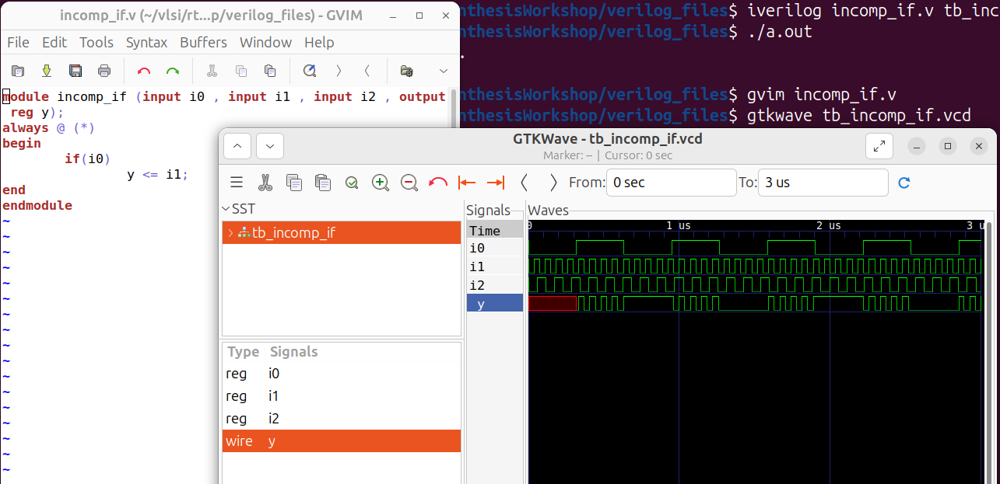  |
| **Synthesis – Yosys** | 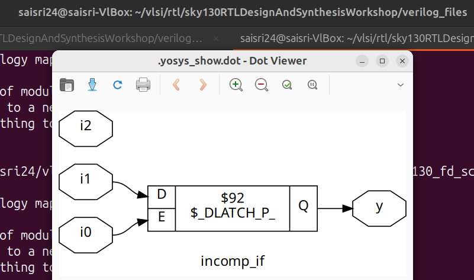 |

### Observations

* When `i0` is zero, the output `y` is observed switching alternately between logic 0 and logic 1 in the simulation.
* The input `i2` is not used in the resulting logic.
* The incomplete conditional assignment can lead to latch inference, depending on the branches and assignments in the RTL.

### 1.3 Incomplete If – Example 2

The second design, `incomp_if2`, was analyzed to understand the behaviour of multiple conditional branches.

The RTL design was simulated, and its synthesized circuit was inspected using Yosys.

**RTL Simulation and Synthesis Comparison**

| Experiment            | Screenshot                                                    |
| --------------------- | ------------------------------------------------------------- |
| **RTL Simulation**    | 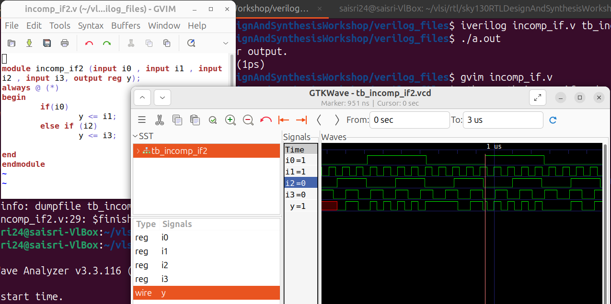  |
| **Synthesis – Yosys** | 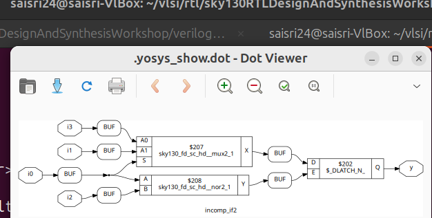 |

### Observations

The following behaviour was observed in the simulation:

* When `i0 = 1`, the output `y` follows `i1`.
* When `i0 = 0` and `i2 = 1`, the output `y` follows `i3`.
* For the remaining condition, the output is observed switching between logic 0 and logic 1 in the waveform.

The synthesized circuit helps visualize how the incomplete conditional assignments are interpreted during synthesis.

### Key Understanding

For combinational logic, every possible input condition should assign a value to the output. Otherwise, the synthesis tool may infer a latch to preserve the previous output value.

---

## 2. Types of Case Statements

### 2.1 Introduction

The `case` statement is used in Verilog to implement multi-way selection logic.

It evaluates an expression and executes the corresponding statement based on the matching condition.

In this workshop, incomplete case statements, complete case statements and partially assigned case statements were analyzed using simulation and synthesis.

### 2.2 Incomplete Case – incomp_case

An incomplete case statement does not provide assignments for every possible input combination.

In this experiment, a multiplexer-like design was implemented using a `case` statement with incomplete conditions.

**RTL Simulation and Synthesis Comparison**

| Experiment            | Screenshot                                                     |
| --------------------- | -------------------------------------------------------------- |
| **RTL Simulation**    | 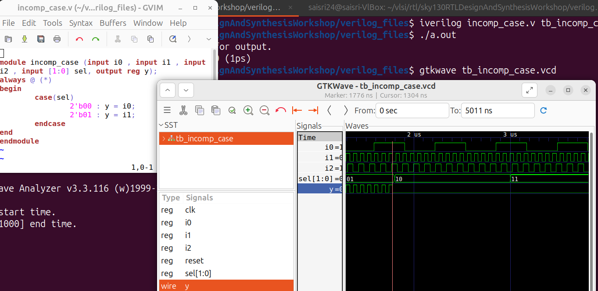  |
| **Synthesis – Yosys** | 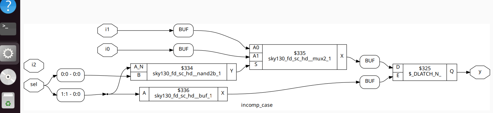 |

### Observations

The following output behaviour was observed:

* When `sel = 2'b00`, the output `y` follows `i0`.
* When `sel = 2'b01`, the output `y` follows `i1`.
* When `sel = 2'b10` or `sel = 2'b11`, the output `y` remains LOW in the observed waveform.
* Input `i2` is not used in the resulting logic.

An incomplete case statement can infer storage elements if the output is not assigned in every possible branch. The actual inferred hardware depends on the assignments in the RTL.

### 2.3 Complete Case – comp_case

A complete case statement provides an assignment for every possible selection condition.

In this experiment, all four combinations of the two-bit select signal were handled.

**RTL Simulation and Synthesis Comparison**

| Experiment            | Screenshot                                                 |
| --------------------- | ---------------------------------------------------------- |
| **RTL Simulation**    | 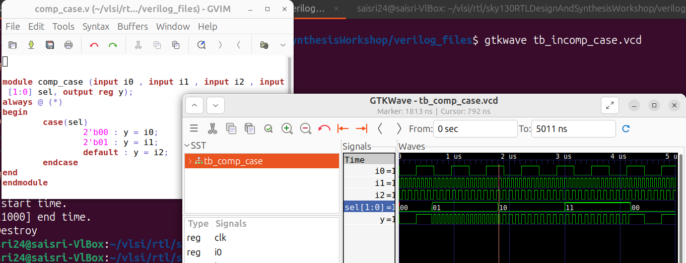  |
| **Synthesis – Yosys** | 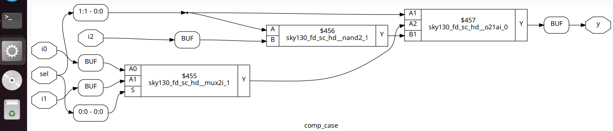 |

### Observations

The output behaviour was verified as follows:

* When `sel = 2'b00`, the output `y` follows `i0`.
* When `sel = 2'b01`, the output `y` follows `i1`.
* When `sel = 2'b10`, the default branch selects `i2`.
* When `sel = 2'b11`, the default branch selects `i2`.

Since all possible select conditions are covered, the design provides a complete assignment for the output.

### 2.4 Partial Case Assignment – partial_case_assign

In this experiment, a design with partial assignments inside a case statement was analyzed using Yosys.

A partial assignment occurs when a signal is not assigned in every possible branch of a case statement.

Such coding styles can cause the synthesis tool to infer latches to retain previous values whenever an assignment is missing.

**Synthesis using Yosys**

**Image 9: Yosys synthesis visualization of the partial_case_assign design.**

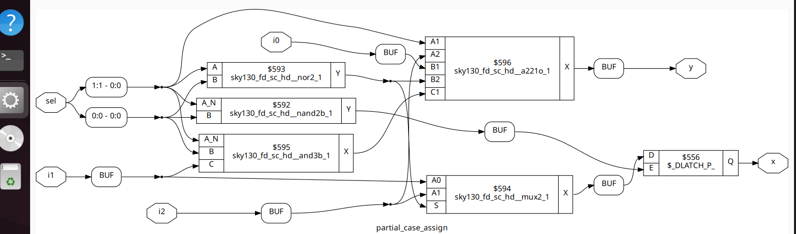

### 2.5 Bad Case – bad_case

The `bad_case` design was analyzed to compare RTL simulation with gate-level simulation.

The design was simulated using Icarus Verilog, synthesized using Yosys and then simulated again using the generated gate-level netlist.

**RTL vs Gate-Level Simulation Comparison**

| Experiment                | Screenshot                                                 |
| ------------------------- | ---------------------------------------------------------- |
| **RTL Simulation**        | 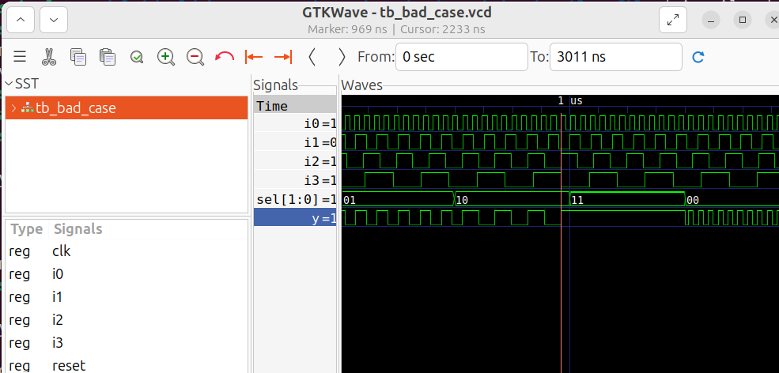        |
| **Gate-Level Simulation** | 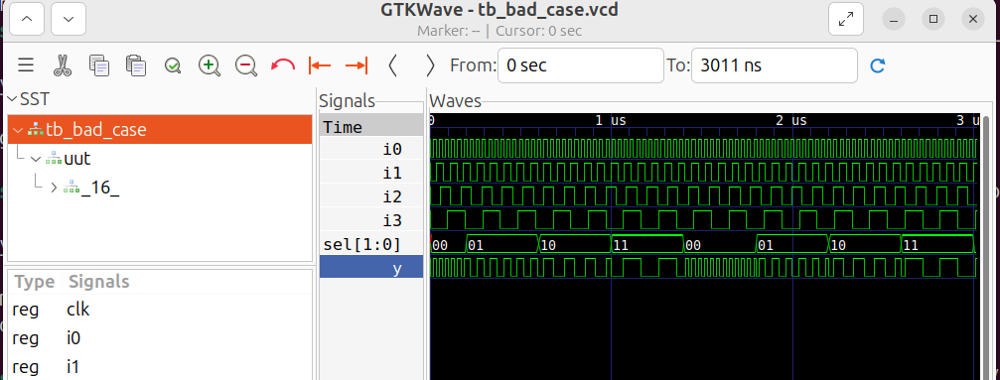 |

### Observations

A difference was observed between the RTL and gate-level simulation results.

* **RTL Simulation:** When `sel = 2'b11`, the output `y` is observed as logic 1.
* **Gate-Level Simulation:** When `sel = 2'b11`, the output `y` follows input `i3`.

The gate-level waveform shows the expected multiplexer selection behaviour for this condition.

**Image 12: Yosys synthesized circuit of the bad_case design.**

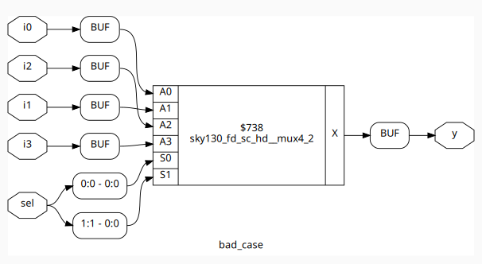

This experiment demonstrates the importance of comparing RTL and gate-level simulation results to identify differences in design behaviour.

---

## 3. MUX and DEMUX Design

### 3.1 MUX using Generate Construct – mux_generate

A multiplexer selects one input from multiple data inputs based on the selection signal.

In this experiment, a multiplexer was implemented using a Verilog `for` loop inside a generate construct.

The generate loop was used to create repeated logic structures and check the selection condition for different inputs.

**Concept:**

* Multiple data inputs are available.
* The selection signal determines which input is connected to the output.
* The generated logic implements the required input selection behaviour.

**Image 13: RTL simulation waveform of the mux_generate design.**

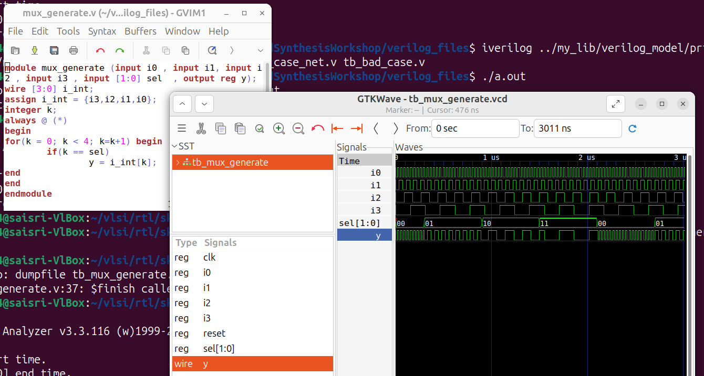

### 3.2 DEMUX Design

A demultiplexer performs the opposite operation of a multiplexer.

It takes a single input and routes it to one of several output lines depending on the selection signal.

In this workshop, two DEMUX implementations were analyzed:

* `demux_case` – Implemented using a case statement.
* `demux_generate` – Implemented using a generate construct.

Both designs were simulated to compare their output behaviour.

### Simulation Commands

### 3.3 DEMUX Simulation Comparison

| Experiment                         | Screenshot                                              |
| ---------------------------------- | ------------------------------------------------------- |
| **DEMUX using Case Statement**     | 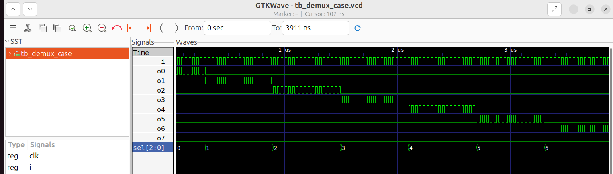         |
| **DEMUX using Generate Construct** | 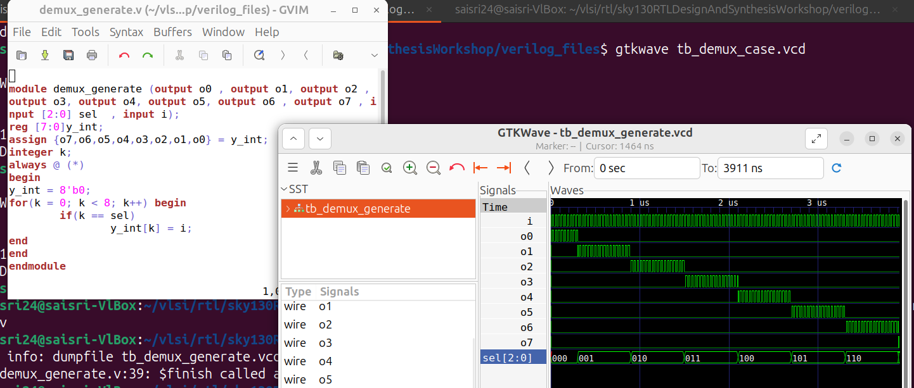 |

### Observations

Both DEMUX designs were implemented using different Verilog coding styles.

* The first implementation uses a `case` statement to select the output line.
* The second implementation uses a generate construct and selection logic.
* Although the coding approaches are different, both implementations exhibit the same output behaviour for the tested input combinations.

This demonstrates that the same hardware functionality can be described using different RTL coding approaches.

---

## 4. Ripple Carry Adder (RCA)

### 4.1 Introduction

A Ripple Carry Adder (RCA) is a combinational digital circuit used to perform binary addition.

It is constructed by connecting multiple Full Adders in series, where the carry output of one stage is connected to the carry input of the next stage.

Each Full Adder performs addition of three inputs:

* `a` – First operand bit.
* `b` – Second operand bit.
* `cin` – Carry input.

It generates two outputs:

* `sum` – Result of binary addition.
* `cout` – Carry output.

### 4.2 Full Adder Design

The Full Adder was implemented separately in a Verilog file named `fa.v`.

The module was then instantiated multiple times inside the Ripple Carry Adder design.

### 4.3 Ripple Carry Adder Design

The Ripple Carry Adder was implemented in a separate Verilog file named `rca.v`.

The `rca` module uses the Full Adder module from `fa.v` to construct the complete multi-bit adder.

The carry output from each Full Adder is connected to the carry input of the next stage.

**Image 16: Verilog implementation of the Full Adder (fa.v) and Ripple Carry Adder (rca.v).**

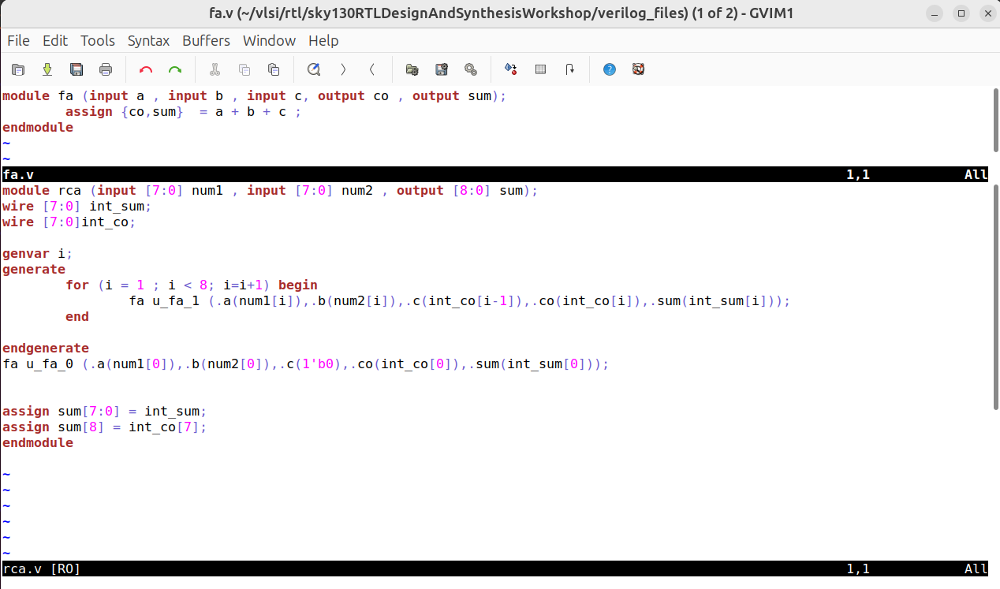

### 4.4 RTL Simulation

Since the RCA design instantiates the Full Adder module, both Verilog source files must be compiled along with the testbench.

**Image 17: RTL simulation waveform of the Ripple Carry Adder showing the addition and carry propagation.**

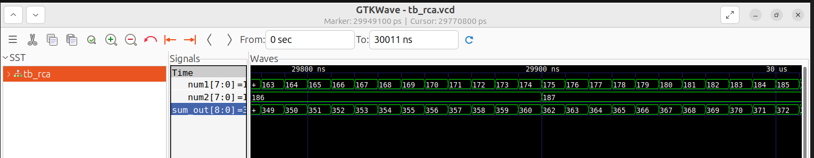

### 4.5 Synthesis using Yosys

The Full Adder and Ripple Carry Adder modules were synthesized together using Yosys.

Both files must be read before synthesis because the RCA design depends on the Full Adder module.

The synthesized design shows the logic implementation of the Ripple Carry Adder.

**Image 18: Yosys synthesized circuit visualization of the Ripple Carry Adder.**

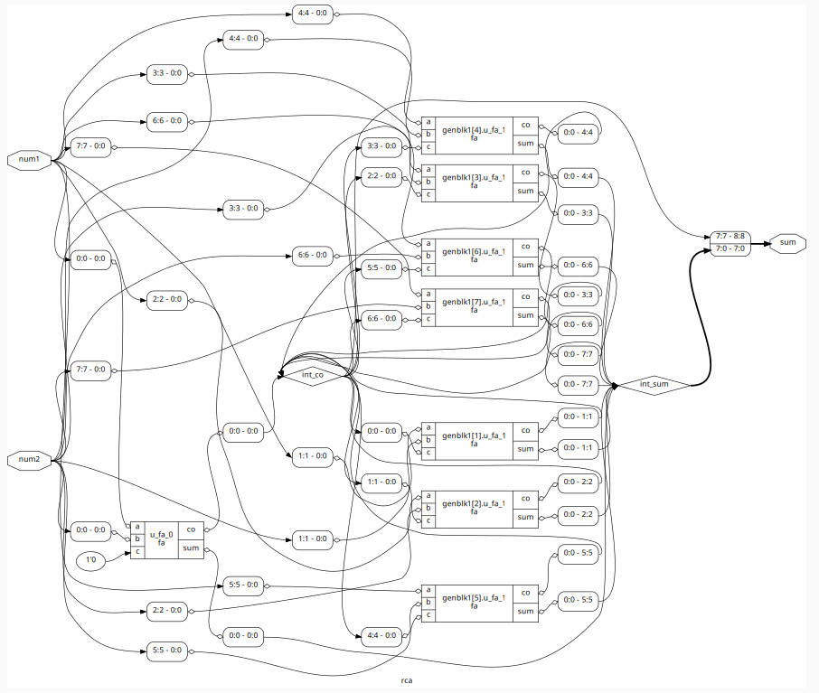

### 4.6 Observation

The RTL simulation waveform confirms that the Ripple Carry Adder performs binary addition correctly.

The carry output from each Full Adder is propagated to the next stage, allowing the complete multi-bit addition operation to be performed.

The Yosys synthesized circuit provides a graphical representation of the resulting adder logic.

---

## 5. Learning Outcomes and Conclusion

Day 5 provided practical exposure to different RTL coding styles, conditional logic, multiplexers, demultiplexers and arithmetic circuit design.

### Key Learning Outcomes

1. **Incomplete If Statements:** Understood how missing assignments in conditional statements can result in latch inference and affect circuit behaviour.

2. **Case Statements:** Learned the differences between incomplete and complete case statements and how missing conditions affect synthesis.

3. **RTL and Gate-Level Comparison:** Gained experience comparing simulation results to identify differences between RTL behaviour and synthesized implementations.

4. **MUX and DEMUX Design:** Implemented multiplexers and demultiplexers using different Verilog coding approaches, including case statements and generate constructs.

5. **Hierarchical Design:** Understood how a Full Adder module can be reused as a submodule to construct a larger Ripple Carry Adder.

### Overall Understanding

This workshop demonstrated how different Verilog coding styles influence the hardware inferred during synthesis.

Overall, the five-day RTL Design and Synthesis workshop provided practical understanding of Verilog coding, simulation, logic optimization, synthesis and gate-level verification using open-source tools and the SKY130 standard-cell library.
